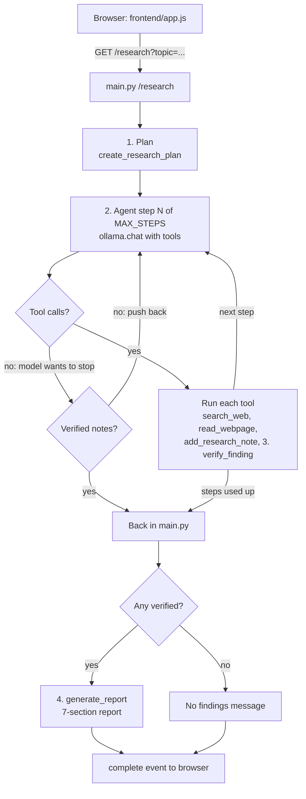

# Research AI Agent

A local research assistant: type a topic, and the agent **plans**, **searches the web**, **saves findings with evidence**, **verifies** each one, and writes a **7-section report** from verified findings only. Progress streams live to the browser.

Everything runs on your own machine with [Ollama](https://ollama.com) and the `qwen3:1.7b` model. No API keys, no cloud AI services.

Final project (Day 21) of a 21-day AI agent course.

## How it works



1. **Plan**: one LLM call turns the topic into a short numbered research plan.
2. **Research loop**: the model chooses tools; Python runs them and sends the results back. Capped at `MAX_STEPS`.
3. **Verify**: `verify_finding` asks a second LLM call whether the saved evidence supports the finding. Only supported findings are marked verified.
4. **Synthesize**: `generate_report` writes the report from verified findings only.

The agent loop is written by hand with `ollama.chat(tools=...)` rather than a framework, so every step is visible in the code.

## Project structure

| File | Role |
| --- | --- |
| `main.py` | FastAPI server: `/` (web UI), `/research` (streaming, used by the UI), `/chat` (JSON), `/health` |
| `agent.py` | Plan, research loop, report writing; `MAX_STEPS` and run time limit |
| `tools.py` | Tools the model can call (`search_web`, `read_webpage`, `add_research_note`, `get_research_notes`, `verify_finding`) and the per-request `ResearchSession` |
| `llm.py` | Ollama connection: `MODEL` and call timeout, used by both files above |
| `schemas.py` | Pydantic request/response models for `/chat` |
| `frontend/` | `index.html`, `app.js` (reads the event stream), `style.css` |
| `Dockerfile`, `docker-compose.yml`, `.env.example` | Run Ollama + the app on a server |
| `DEPLOY.md` | Step-by-step: deploy on a free Oracle Cloud server |

## Tech stack

| Tool | Used for |
| --- | --- |
| Ollama + Qwen3 1.7B | Local LLM: planning, tool choice, verification, report |
| `ollama` Python library | `chat()` calls, tool schemas from Python functions, JSON mode |
| DuckDuckGo HTML search + `requests` | Web search and page download (no API key) |
| BeautifulSoup 4 | HTML to plain text |
| FastAPI + Uvicorn | Web server and API |
| Server-Sent Events | Live progress in the browser |

## Requirements

- Python 3.12 or newer
- [Ollama](https://ollama.com/download) installed and running
- The model: `ollama pull qwen3:1.7b`

## Run it (Windows PowerShell)

```powershell
# 1. Create and activate a virtual environment
python -m venv .venv
.\.venv\Scripts\Activate.ps1

# 2. Install dependencies
pip install -r requirements.txt

# 3. Check Ollama: http://localhost:11434 should say "Ollama is running"
#    If not:  ollama serve

# 4. Start the app
$env:OLLAMA_HOST = "http://localhost:11434"
uvicorn main:app --reload
```

Open **http://localhost:8000**, enter a topic, and click **Start Research**. Stop the server with **Ctrl+C**.

On macOS/Linux, activate with `source .venv/bin/activate` and set the variable with `export OLLAMA_HOST=http://localhost:11434`.

### API

Interactive docs at http://localhost:8000/docs.

```powershell
curl.exe -X POST http://localhost:8000/chat -H "Content-Type: application/json" -d '{\"message\": \"Impact of generative AI on software development\"}'
```

## Deploy to a server

See **[DEPLOY.md](DEPLOY.md)** for a free Oracle Cloud server. On any Linux server with Docker and 4+ GB RAM:

```bash
cp .env.example .env      # then set APP_PASSWORD
docker compose up -d --build
```

The app is then at `http://SERVER-IP`. One research runs at a time; visitors are rate-limited and asked for the password.

## Settings

Set as environment variables (in `.env` when using Docker). Defaults suit local use.

| Setting | Default | Notes |
| --- | --- | --- |
| `MODEL` | `qwen3:1.7b` | Larger models are more accurate but slower on CPU. |
| `MAX_STEPS` | `5` | Agent loop steps. Raise if runs end with "No verified findings". |
| `LLM_TIMEOUT` | `300` | Seconds one model call may take. |
| `RESEARCH_TIMEOUT` | `900` | Seconds one whole research run may take. |
| `APP_PASSWORD` | empty | If set, the browser asks for this password (any user name). |
| `RATE_LIMIT_PER_HOUR` | `10` | Research runs per visitor IP per hour. |
| `MAX_TOPIC_CHARS` | `500` | Longest topic accepted. |

`MAX_PAGE_CHARS` (`4000`, in `tools.py`) sets how much of each web page the model sees. Lower = faster.

## Performance notes

- On CPU, each model call can take a while. `/no_think` at the start of each system prompt stops Qwen3 from writing a long reasoning block first.
- Every message stays in the conversation and is re-read on each step, so page text is trimmed.

## Known limitations

- `verify_finding` checks the evidence the model supplied; it does not yet confirm the evidence appears on the fetched page.
- One research at a time: a CPU model can't serve parallel requests, so others get "busy, try again".
- The optional password uses HTTP Basic auth; without HTTPS it is not encrypted.
- DuckDuckGo's HTML page may rate-limit or change its layout.
- Web page text goes straight into the prompt (prompt injection is possible).
